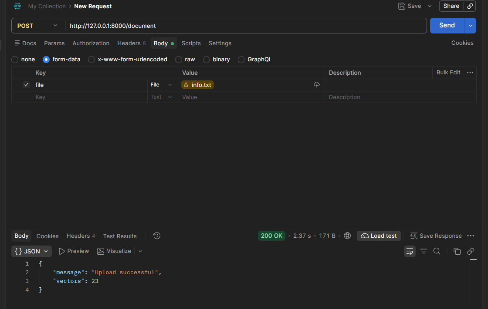
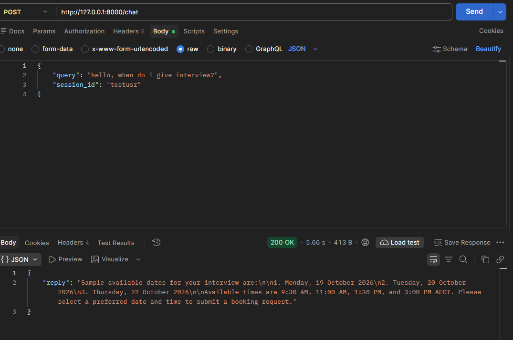
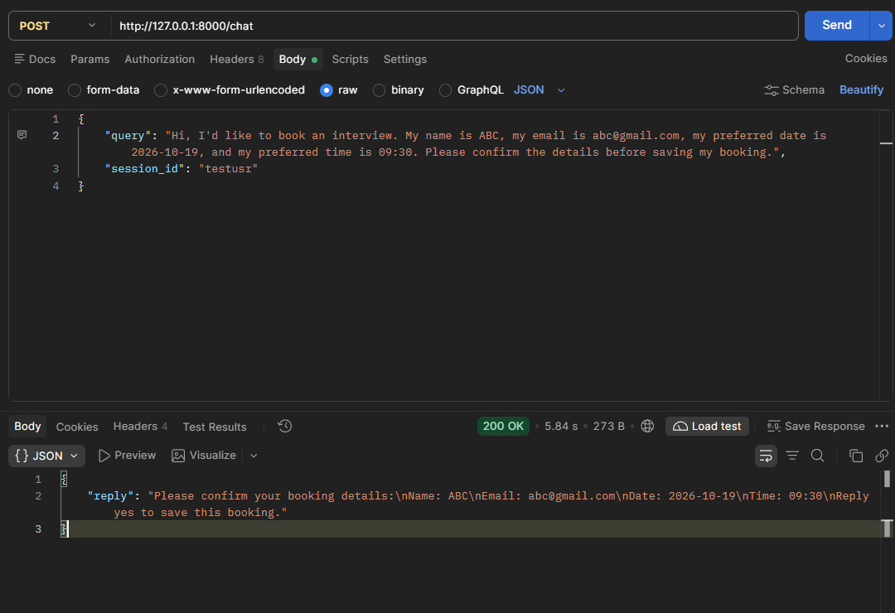
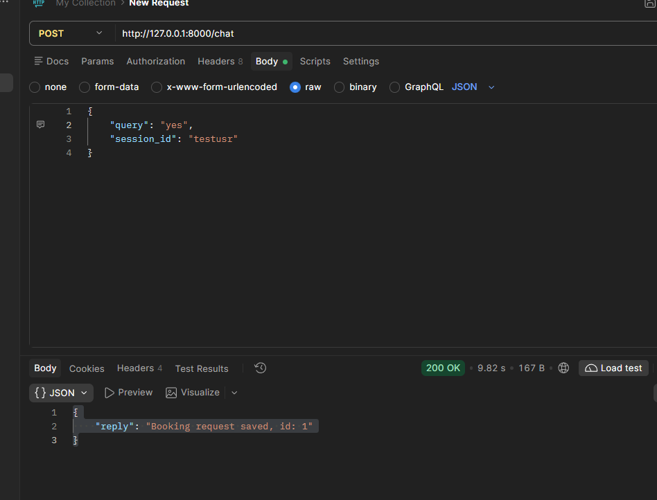
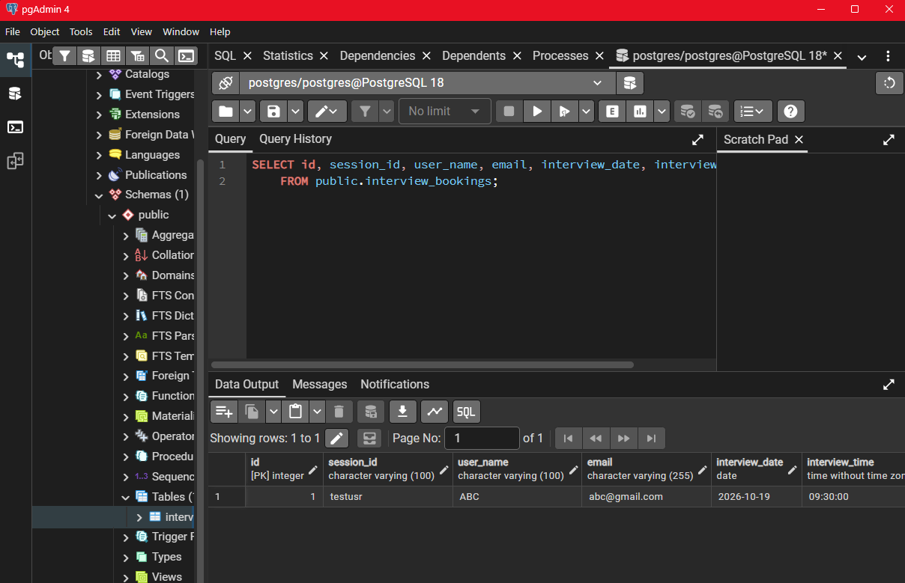
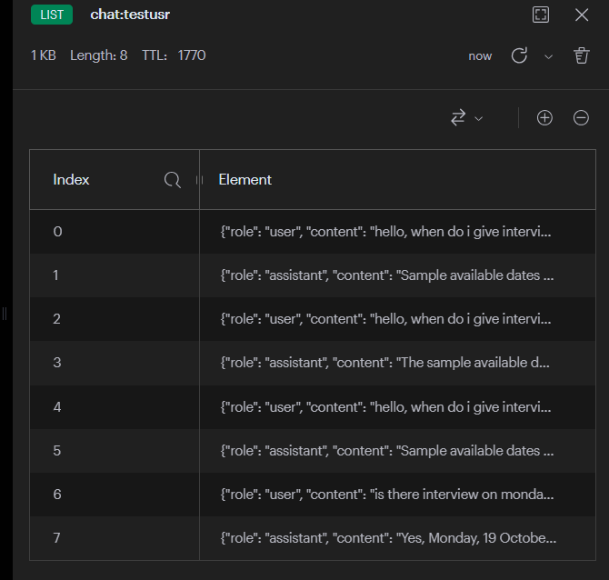
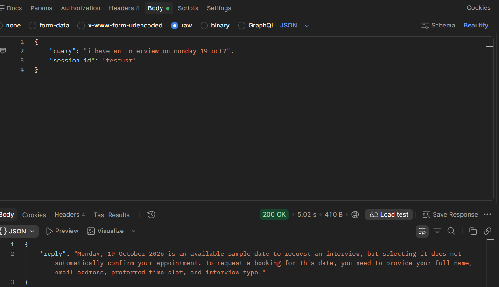
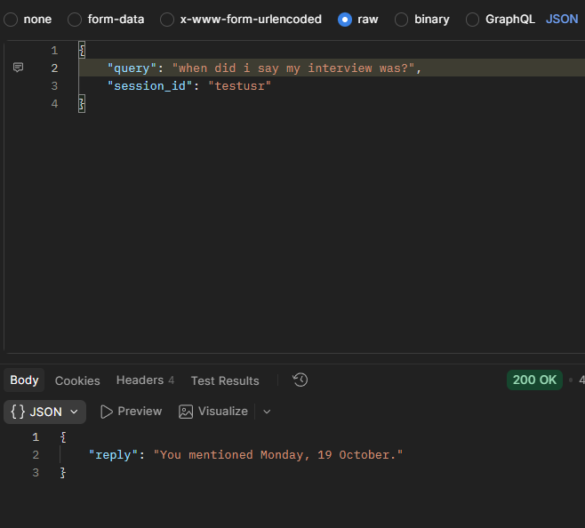

# AI-Powered Interview Assistant
This project is a backend for an AI-powered interview assistant that can answer questions from uploaded documents (.pdf/.txt) and handle interview booking requests.

**### Tech Stack:**

1. FastAPI: Backend REST APIs.
2. Gemini 3.5 Flash: AI responses and query understanding.
3. Ollama Embeddings: Text embedding generation, since it runs locally.
4. Qdrant: Vector storage and similarity search.
5. Recursive Chunking: Preferred chunking strategy based on my results.
6. Semantic Chunking: Alternative chunking strategy for comparison.
7. RAG: Context-based answers from uploaded documents.
8. Redis: Conversation history and session management.
9. PostgreSQL: Interview booking storage.
10. SQLAlchemy: Database interaction and ORM.

**### File Description**

1. main.py starts the FastAPI app, connects the API routes, and creates the database tables.
2. api/document.py handles document uploads, while api/chat.py manages chat messages, AI responses, conversation history, and interview bookings.
3. ingest.py extracts text from PDF and TXT files and splits it using recursive or semantic chunking.
4. embeddings.py sets up the Ollama embedding model, and qdrant_store.py stores document chunks and their embeddings in Qdrant.
5. rag.py finds relevant information from uploaded documents to help answer user questions.
6. redis_history.py saves and retrieves chat history using Redis.
7. booking.py checks the interview details and saves booking requests to PostgreSQL. booking_schema.py defines the structure of the booking information.
8. database/database.py manages the PostgreSQL connection, database/models.py defines the interview booking table, and database/database_schema.py provides the SQLAlchemy base for the models.
9. schema.py defines the format of requests sent to the chat API.
10. sample_files/info.txt is a sample text file that can be uploaded to test.

**### To pull and use:**

1. Clone the repository:
   git clone https://github.com/Rizan012/interview-ai-assistant.git
   cd interview-ai-assistant

2. Install dependencies:
   uv sync

3. Create a .env file with your Gemini API key and Qdrant, Redis, and PostgreSQL connection details.

4. Install Ollama and download the embedding model I used:
   ollama pull nomic-embed-text

   I used OllamaEmbeddings(model="nomic-embed-text") since it runs locally.

5. Run the API:
   uv run uvicorn main:app --reload

6. Open http://127.0.0.1:8000/docs to test the APIs.

**### Results**

A. Document Upload

B. Normal Text Query

C. Booking an Interview

D. Confirming and Completing Booking

E. Redis Conversation History:

F. LLM Remembers History:

